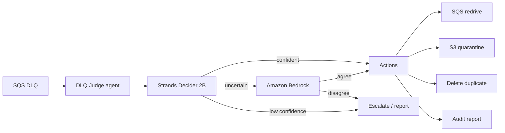

# DLQ Judge

[](LICENSE)

Triage SQS dead-letter queues with **Strands Decider 2B** and an Amazon Bedrock fallback.

## The problem

Failed messages pile up in SQS DLQs. Manual triage does not scale, and blindly redriving or deleting is unsafe. Operators need a confidence-aware agent that acts only when evidence is strong and escalates when it is not.

## What the agent does

For each DLQ message the agent chooses one of five actions:

| Action | Meaning |
|---|---|
| `redrive_now` | Retry immediately to the source queue |
| `redrive_later` | Retry after a delay |
| `quarantine_poison` | Park the payload in S3 for engineering |
| `discard_duplicate` | Drop a confirmed duplicate (guarded) |
| `escalate_human` | Leave for a human |

## Strands Decider 2B decision

**Question:** *What is the safest next action for this failed message?*

| Top probability | Path |
|---|---|
| ≥ 0.85 | Auto-act (Decider only) |
| 0.60 – 0.85 | Bedrock second opinion; act only if it agrees |
| < 0.60 | Escalate |
| discard special | Requires ≥ 0.90 **and** an idempotency key |

Bedrock is used only in the uncertain band so cost and latency stay low when Decider 2B is already confident.

## Architecture



## Reusable pattern

Copy-ready module: [`patterns/confidence-gated-action/`](patterns/confidence-gated-action/)

Python import: `patterns.confidence_gated_action`

Confidence-gated action with LLM fallback — typed options, thresholds, guards, and a pluggable Bedrock interface. The main agent uses this pattern in production triage (not a side demo).

## Benchmark

From `bench/results/results.md` (real `bench/run_bench.py` output):

| Approach | Accuracy | Unsafe rate | Median ms | p95 ms | Bedrock/1k |
|---|---|---|---|---|---|
| Rules | 1.0 | 0.0 | 0 | 0 | 0.0 |
| Bedrock only | 0.0667 | 0.0 | 1136 | 1695 | 1000.0 |
| DLQ Judge | 0.0667 | 0.0 | 3537 | 4103 | 0.0 |

Re-run: `python -m bench.run_bench` (requires Decider + AWS as configured). Do not invent numbers.

## Setup

**Prerequisites:** Python 3.11+, AWS account (us-east-1), Strands Decider 2B endpoint, Bedrock model access.

**IAM (minimal):** SQS receive/delete/send on `dlqj-*`, S3 put/get on quarantine bucket, Bedrock invoke, optional Cognito for the UI.

```bash
python -m venv .venv
source .venv/Scripts/activate   # Git Bash on Windows
pip install -e ".[dev]"
cp .env.example .env            # fill required values
```

**Dry-run triage (default / safe):**

```bash
dlq-judge triage
# or
python -m dlq_judge.cli triage
```

**Apply actions:**

```bash
dlq-judge triage --apply
```

**UI:**

```bash
dlq-judge ui
```

## Deploy to AWS (us-east-1, minimal cost)

```bash
aws cloudformation deploy \
  --template-file infra/template.yaml \
  --stack-name dlq-judge \
  --capabilities CAPABILITY_NAMED_IAM \
  --region us-east-1
```

Prefer a small CPU instance when GPU quota is zero. Stop the instance when idle.

## Deploy on Vercel (no EC2)

The UI and API run as one Vercel Function (`api/index.py`). The Decider question is answered on demand by
Amazon Bedrock (`DLQJ_DECIDER_URL=bedrock`) instead of the local 2B model, runs and jobs are stored in S3
(`DLQJ_STATE_BUCKET`), and AWS access uses Vercel OIDC (`AWS_ROLE_ARN`, created by the stack when
`VercelTeamSlug` is set). Set the `DLQJ_*` variables from the stack outputs, then `vercel deploy --prod`.

## Demo

- Video: `VIDEO_URL`
- Live app: `APP_URL`

## Safety

- Dry-run by default (`--apply` required to mutate)
- PII masking before Decider / logs
- Per-run audit log under `DLQJ_RUNS_DIR`
- Discard guard + confidence bands

## License

Apache License 2.0 — Copyright 2026 Syed Moiz. See [LICENSE](LICENSE).
