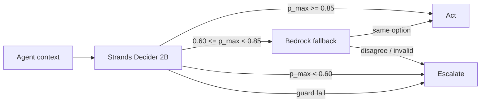

# Reusable Strands Decider 2B decision pattern: Confidence-gated action with LLM fallback

## What it does

This pattern asks Strands Decider 2B for a probability over a typed set of actions, then applies confidence bands before acting. High confidence executes automatically; the uncertain band requires an Amazon Bedrock second opinion to agree; low confidence escalates. Per-action guards (for example discard) can raise the bar further.

## When to use it

Use it in any agent that must choose between risky side effects (retries, deletes, routing, refunds) where a small model ranks options and you only want a larger LLM involved when confidence is middling.

## The typed question and options

Default DLQ Judge set:

- **Question:** `What is the safest next action for this failed message?`
- **Options:** `redrive_now`, `redrive_later`, `quarantine_poison`, `discard_duplicate`, `escalate_human`

Pass your own question and options with `make_option_set(...)`.

## How it is wired into the agent's path



```
context --> Decider 2B --> probabilities
                 |-- >= auto_min ----------> action (path=auto)
                 |-- review band ----------> Bedrock?
                 |         |-- agree ------> action (path=bedrock_agreed)
                 |         |-- disagree ---> escalate
                 |-- < review_min ---------> escalate (path=low_confidence)
                 |-- guard fail -----------> escalate (path=rule)
```

DLQ Judge imports `decide()` from this package inside the triage loop (`dlq_judge` / `agent` engine).

## Quick start

```python
from patterns.confidence_gated_action import PolicyConfig, decide, dlq_option_set
from patterns.confidence_gated_action.bedrock import CallableBedrockFallback

def my_decider(ctx, option_set):
    # call Strands Decider 2B; return (choice, probs, latency_ms)
    return "redrive_now", {"redrive_now": 0.9, "escalate_human": 0.1}, 12

decision = decide(
    {"has_idempotency_key": False},
    dlq_option_set(),
    PolicyConfig.dlq_defaults(),
    decider=my_decider,
    bedrock=CallableBedrockFallback(lambda c, o, p: p),
)
print(decision.action, decision.path)
```

## Configuring thresholds and guards

```python
from patterns.confidence_gated_action import ActionGuard, PolicyConfig

policy = PolicyConfig(
    auto_min=0.85,
    review_min=0.60,
    guards={"discard_duplicate": ActionGuard(min_confidence=0.90, require_attr="has_idempotency_key")},
    use_bedrock=True,
)
```

Set `use_bedrock=False` or pass `NullBedrockFallback()` to skip the LLM fallback.

## Adapting to your own use case

Support ticket routing example:

```python
from patterns.confidence_gated_action import PolicyConfig, decide, make_option_set

tickets = make_option_set(
    "How should we handle this support ticket?",
    ["auto_reply", "assign_team", "escalate"],
    criteria={
        "auto_reply": "Clear FAQ match; safe auto response.",
        "assign_team": "Needs specialist; route to a queue.",
        "escalate": "Angry or unsafe; human now.",
    },
)
d = decide(
    {"priority": "low"},
    tickets,
    PolicyConfig(auto_min=0.8, review_min=0.55, escalate_action="escalate", use_bedrock=False),
    probabilities={"auto_reply": 0.82, "assign_team": 0.1, "escalate": 0.08},
    choice="auto_reply",
)
assert d.path == "auto"
```

## Python import name

Folder: `patterns/confidence-gated-action/`. Import as `patterns.confidence_gated_action` (see `pyproject.toml` package-dir mapping).
